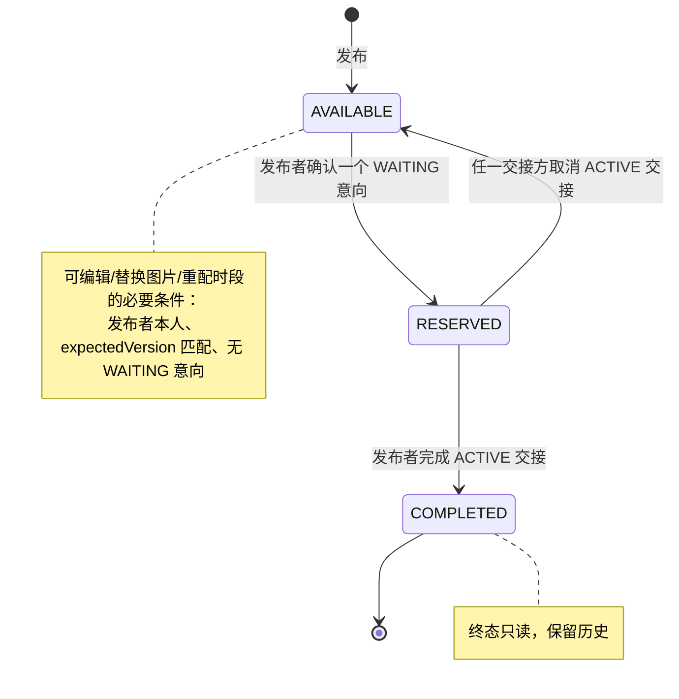
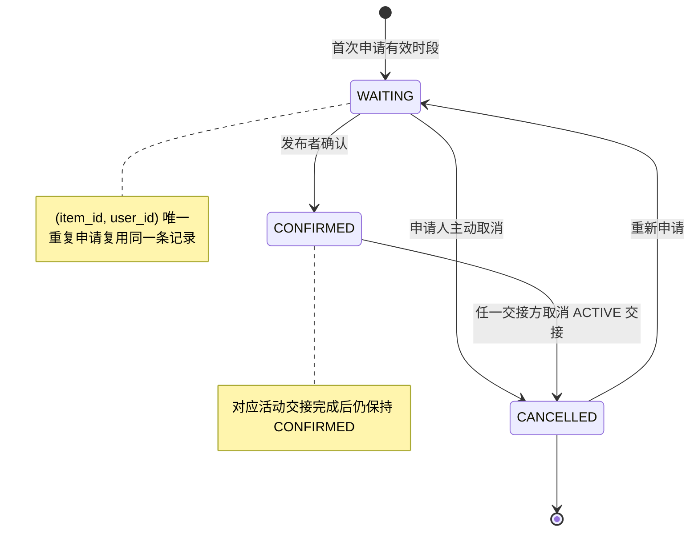
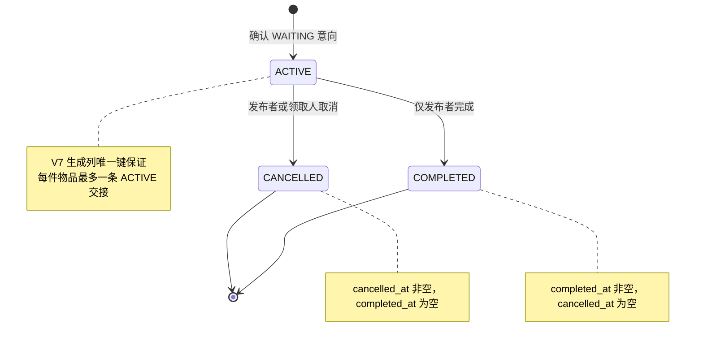

# 状态机与并发时序

本文对应 NM-G-04，以当前 Service、Mapper、Flyway V7/V8 约束和真实 MySQL 并发测试为准。图中 409 表示状态、版本或并发前置条件不再成立；调用方应刷新权威状态，不得自动覆盖。

## 1. 三个关联状态机

### 1.1 物品



### 1.2 领取意向



### 1.3 交接



三个状态机不是独立更新：确认、取消和完成必须在一个本地事务内维护关联状态。V7 CHECK、唯一键与复合外键负责阻止非法组合；Service 的权限和条件 UPDATE 负责决定谁能触发转换。

## 2. 编辑与申请并发

编辑和领取申请都携带详情页读到的 `expectedVersion`，并先锁定同一物品行。锁获得顺序使两个事务串行检查版本和业务条件。

```mermaid
sequenceDiagram
    actor P as 发布者
    actor A as 申请人
    participant E as ItemService.update
    participant W as InterestWorkflowService.want
    participant DB as MySQL

    par 编辑请求
        P->>E: PUT item (expectedVersion = V)
        E->>DB: BEGIN; SELECT item FOR UPDATE
    and 申请请求
        A->>W: POST interest (expectedItemVersion = V)
        W->>DB: BEGIN; SELECT item FOR UPDATE
    end

    alt 编辑先获得行锁
        DB-->>E: item AVAILABLE, version V
        E->>DB: 校验无 WAITING; 条件 UPDATE version V -> V+1
        E->>DB: 旧时段 inactive; 插入新时段; COMMIT
        DB-->>W: 获锁后读到 version V+1
        W-->>A: ROLLBACK; 409，请刷新后重新核对
    else 申请先获得行锁
        DB-->>W: item AVAILABLE, version V
        W->>DB: upsert WAITING 意向; COMMIT
        DB-->>E: 获锁后发现 WAITING 意向
        E-->>P: ROLLBACK; 409，存在领取意向
    end
```

结果只有两种合法形态：编辑成功且申请因旧版本失败，或申请成功且编辑因 WAITING 意向失败。编辑事务中任一字段/时段写入失败时，物品字段、版本、旧时段停用和新时段插入全部回滚。

## 3. 两人同时被确认

确认流程先读取候选意向和时段，再以条件 UPDATE 抢占物品。它没有依赖“先读后信任”，最终胜负由数据库中 `status=AVAILABLE AND current_handover_id IS NULL` 的原子更新决定。

```mermaid
sequenceDiagram
    actor P1 as 确认请求 A
    actor P2 as 确认请求 B
    participant S as HandoverWorkflowService
    participant DB as MySQL

    par 两个事务同时开始
        P1->>S: confirm(interest A)
        S->>DB: 校验 A 为 WAITING、时段有效
    and
        P2->>S: confirm(interest B)
        S->>DB: 校验 B 为 WAITING、时段有效
    end

    P1->>DB: UPDATE item AVAILABLE -> RESERVED
    P2->>DB: UPDATE item AVAILABLE -> RESERVED
    DB-->>P1: 影响 1 行（胜者）
    DB-->>P2: 影响 0 行（败者）
    P1->>DB: INSERT ACTIVE handover
    P1->>DB: item.current_handover_id = handover.id
    P1->>DB: interest A WAITING -> CONFIRMED; COMMIT
    P2-->>P2: ROLLBACK; 409
```

最终必须且只会存在一条 ACTIVE 交接、一条 CONFIRMED 意向和一个指向该交接的 RESERVED 物品；另一条意向保持 WAITING。V7 的 `uq_handover_active_item` 是第二道数据库防线。

## 4. 取消与完成竞争

取消和完成都以 `handover.status=ACTIVE` 为条件更新同一交接。第一个成功更新的事务决定终态；另一个事务影响 0 行并返回 409。

```mermaid
sequenceDiagram
    actor R as 交接任一方
    actor P as 发布者
    participant S as HandoverWorkflowService
    participant DB as MySQL

    par 取消
        R->>S: cancel(handoverId)
        S->>DB: UPDATE handover ACTIVE -> CANCELLED
    and 完成
        P->>S: complete(handoverId)
        S->>DB: UPDATE handover ACTIVE -> COMPLETED
    end

    alt 取消先成功
        DB-->>S: cancel 影响 1 行; complete 影响 0 行
        S->>DB: item RESERVED -> AVAILABLE; current_handover_id = NULL
        S->>DB: interest CONFIRMED -> CANCELLED; COMMIT
        S-->>P: 409，交接状态已变化
    else 完成先成功
        DB-->>S: complete 影响 1 行; cancel 影响 0 行
        S->>DB: item RESERVED -> COMPLETED; 设置 completed_at; COMMIT
        Note over DB: current_handover_id 保留<br/>interest 保持 CONFIRMED
        S-->>R: 409，交接状态已变化
    end
```

任何结果都不允许同时设置 `cancelled_at` 和 `completed_at`，也不允许留下 ACTIVE 交接。V7 的终态字段 CHECK 对此提供数据库级约束。

## 5. 失败回滚

| 操作 | 注入/检测到的失败 | 必须回滚的内容 | 自动化证据 |
| --- | --- | --- | --- |
| 编辑物品 | 新时段插入或事务中途失败 | 字段、版本、旧时段 active 状态和新时段 | Phase E 验收记录与同一 `@Transactional` 边界 |
| 确认领取人 | 交接插入失败 | `item` 不得停留 RESERVED；意向保持 WAITING；无交接记录 | `confirmationRollsBackItemReservationWhenHandoverInsertFails` |
| 确认领取人 | 设置 current handover 失败 | RESERVED 更新与新交接一并回滚；意向保持 WAITING | `confirmationRollsBackHandoverInsertWhenItemPointerUpdateFails` |
| 取消交接 | 意向取消失败 | handover 保持 ACTIVE；item 保持 RESERVED 并保留当前交接 | `cancellationRollsBackHandoverAndItemWhenInterestUpdateFails` |
| 完成交接 | item 完成失败 | handover 保持 ACTIVE；`completed_at` 不得残留 | `completionRollsBackHandoverWhenItemCompletionFails` |

这些回滚依赖同一个 Spring/MySQL 本地事务，不使用消息队列、Saga 或分布式事务。

证据边界：当前真实 MySQL 故障注入用例分别覆盖确认、取消和完成；编辑/申请已有真实并发竞争测试，编辑失败原子性记录于 Phase E 验收，但测试集中未以独立命名的故障 Trigger 用例呈现。最终自动化审计若要求逐操作故障注入，应为编辑流程补充该用例，不能把事务注解本身当作完整故障测试。

## 6. 重复请求与幂等语义

系统保证“不会重复产生合法业务结果”，但终态写请求不是静默幂等成功：

| 重复操作 | 结果 | 数据保证 |
| --- | --- | --- |
| 重复申请同一物品 | upsert 同一 `(item_id, user_id)` 记录；CONFIRMED 时拒绝 | 不创建重复意向 |
| 重复确认或并发确认 | 首个合法事务成功，其余 409 | 每物品最多一条 ACTIVE 交接 |
| 重复取消意向 | 第二次 409 | CANCELLED 不再变化 |
| 重复取消交接 | 第二次 409 | 只记录一个取消终态 |
| 重复完成交接 | 第二次 409 | 只记录一个完成终态 |
| 用旧版本编辑、申请或修改图片 | 409 | 不覆盖新版本，不产生部分写入 |

选择 409 而不是把重复终态请求伪装成成功，是为了让客户端刷新并展示数据库中的实际胜者和终态。前端按钮禁用与 pending key 只改善交互，最终正确性由事务、条件 UPDATE、版本和数据库约束保证。
