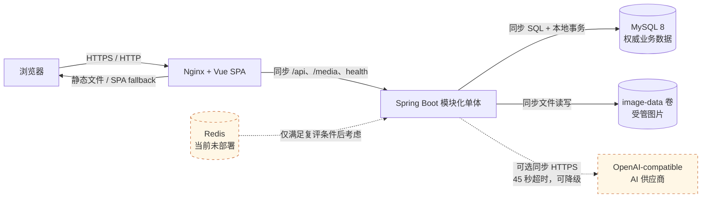
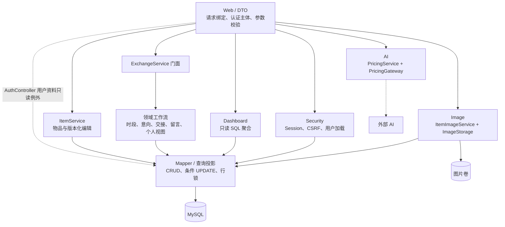

# NeighborMarket 最终架构

## 生产部署与请求链路

实线表示当前部署内的同步调用；虚线表示可选外部能力或未采用组件。前端只调用同源后端 API，不直接访问 MySQL、图片卷或模型供应商。生产 Compose 由 Nginx 托管静态资源并代理 `/api`、`/media` 和唯一公开的健康检查；开发环境由 Vite 将 `/api` 代理到 Spring Boot。

Redis 当前不是运行拓扑的一部分。只有多实例共享 Session、严格跨实例 AI 配额或有指标证明的安全热点缓存需求成立时才重新评估，详见 `REDIS_DECISION.md` 与 `CACHE_DECISION.md`。

## 后端模块边界

承载业务状态变化的 Controller 只进入 Service/安全边界，不直接访问 Mapper。当前 `AuthController` 为登录响应和 `/me` 查询用户资料，存在直接读取 `AppUserMapper` 的窄例外；它不执行业务状态转换。领域模块是同一进程内的 Java 边界，不是网络服务；写事务声明在实际执行状态转换的 Service 上。`PricingGateway` 与 `ImageStorage` 是外部适配器边界，不拥有核心交换状态。

## 数据所有权与一致性

| 数据/能力 | 权威所有者 | 一致性边界 | 其他组件权限 |
| --- | --- | --- | --- |
| 用户、物品、时段、意向、交接、留言 | MySQL | Spring `@Transactional` + 行锁/条件 UPDATE + 数据库约束 | 前端只能经授权 API 读取或变更 |
| Session | 单个 Spring Boot 实例 | 容器内 HttpSession；登录轮换 ID，写请求校验 CSRF | Nginx 只转发 Cookie，不解析身份 |
| 受管图片 | `image-data` 卷；MySQL 保存规范引用 | 新对象先写、数据库切换引用、提交后清理旧对象；失败执行补偿 | Nginx 只代理 `/media`，浏览器不能提交本地路径 |
| 社区看板 | MySQL 业务记录 | 请求时执行只读聚合，不维护第二份统计真相 | 前端只展示返回结果 |
| AI 估价 | 外部供应商生成，用户决定是否采用 | 不进入核心事务；超时/失败降级为手工定价 | 前端不接触 API Key、Prompt 或供应商原始响应 |
| 指标与日志 | Spring Boot 进程 | 固定低基数结果和匿名事件；不记录业务正文 | 不作为业务数据源 |

## 认证与数据边界

- 登录成功后由 Spring Security 使用 HttpOnly、SameSite=Lax Session Cookie 维持会话。
- 发布、想要、确认领取人、交接、留言回复和 AI 估价接口在后端依据当前认证用户授权。
- 前端不提交或保存 publisherId 作为权限依据，发布者身份由后端 Session 用户解析。
- CSRF 防护已启用：前端先获取 CSRF Cookie，并在写请求头中回传 Token；登录成功后由 Spring Security 更换 Session ID。生产 profile 要求 Secure Cookie，演示账号仅在显式 demo profile 下初始化。

## 业务模块

- 广场与详情：物品查询、筛选、时段、意向和公开留言。
- 发布：物品基本信息、公共交接地点、未来时段和 AI 估价辅助。
- 交接：发布者确认领取人，双方可取消，发布者可标记已送出。
- 看板：DashboardService 调用 DashboardMapper 的 SQL 聚合，直接从数据库计算本月发布、本月完成、当前在售及两个排行。

## 后端服务边界

交换业务保持模块化单体，不拆分微服务。`ExchangeService` 是面向 Controller 和现有调用方的兼容门面，只保留稳定的公开方法与响应记录；具体规则按职责拆分：

- `PickupOptionService`：有效时段查询、发布时初始时段和发布者重配时段。
- `InterestWorkflowService`：申请、取消以及发布者/申请人的意向查询。
- `HandoverWorkflowService`：确认领取人、双方取消、发布者完成及交接查询。
- `CommentWorkflowService`：公开留言和发布者一层回复。
- `PersonalExchangeService`：组合当前用户的意向与交接看板。
- `ExchangeSupport`：共享的用户/物品加载、错误创建和响应映射，不承载业务状态转换。

事务边界声明在实际执行写入的领域服务方法上，而不是兼容门面上；业务状态 Controller 不直接访问 Mapper。并发安全由事务内统一行锁顺序、条件 UPDATE、影响行数检查、V7 数据库约束和 V8 物品版本共同保证。

## HTTP 与 DTO 边界

- `web.dto` 保存 HTTP 请求/认证响应模型和 Bean Validation 约束；Controller 不再内嵌传输记录。
- 业务 Controller 只绑定请求、读取认证主体、转换命令并调用 Service，不直接访问 Mapper 或编写业务状态转换；`AuthController` 的用户资料只读查询是当前明确例外。
- `CreateItemCommand` 是物品发布的服务层输入，解除 `ItemService` 对 Web Controller 类型的反向依赖。
- DTO 校验负责必填、长度、数字格式和嵌套时段空值；未来时间、结束晚于开始、价格与交易方式组合等跨字段业务规则仍由 Service 验证。
- Mapper 负责 CRUD、查询投影及事务所需的原子条件 SQL；是否允许执行状态转换由 Service 决定。

## 前端请求一致性

- 页面级读取通过 `createLatestRequest` 管理；发起新请求时中止旧请求，并以请求序号拒绝迟到响应。
- 市场筛选、详情、我的页面、社区看板和 AI 估价在组件卸载时取消未完成请求，取消不会显示成网络错误。
- 详情页的公开数据与认证后意向数据完成后一次性提交到页面状态，避免混合不同物品或不同加载轮次的数据。
- 登录、发布、估价和状态操作同时使用按钮禁用与函数级 busy 守卫，降低双击及程序化重复触发风险；服务端事务、幂等和条件更新仍是最终一致性保障。
- 操作级 pending 使用业务资源 key：同一物品的意向操作、同一交接的取消/完成彼此互斥，不同留言、交接或配置操作不会被一个全局 busy 无关阻塞。
- 写操作成功后重新读取服务端最终状态；表单内容只在成功后清理，失败时保留以便用户修正和重试。前端防重只改善交互，不能替代服务端幂等与并发控制。

## AI 估价边界

调用链为 PublishView -> POST /api/ai/pricing -> PricingService -> PricingGateway -> OpenAI-compatible Chat Completions。LLM 调用只发生在后端，API Key、供应商原始响应和 Prompt 不下发前端、不写入日志。后端校验 NEED_MORE_INFO 与 ESTIMATE 结构，设置 45 秒请求超时及每个登录用户 60 秒频率限制；429、超时、供应商错误、非法结构或信息不足均回到可手工填写价格的降级路径。

## 数据库演进

Flyway 按 V1～V8 顺序执行：

1. V1 创建用户和物品基础表。
2. V2 强化 last_confirmed_at 并增加索引。
3. V3 增加交接时段、意向、交接、交接地点和当前交接引用。
4. V4 增加公开留言的一层回复自关联。
5. V5 只增加看板查询索引，不增加业务表或业务流程。
6. V6 为交接时段增加 active 标志；重配只停用旧时段，不删除仍被历史意向引用的记录。
7. V7 增加状态 CHECK、单物品 ACTIVE 交接唯一约束及同物品/用户复合外键；迁移在任何 DDL 前检查已有数据兼容性。
8. V8 为物品增加乐观并发版本字段，支持编辑和领取申请以同一版本与行锁顺序竞争。
