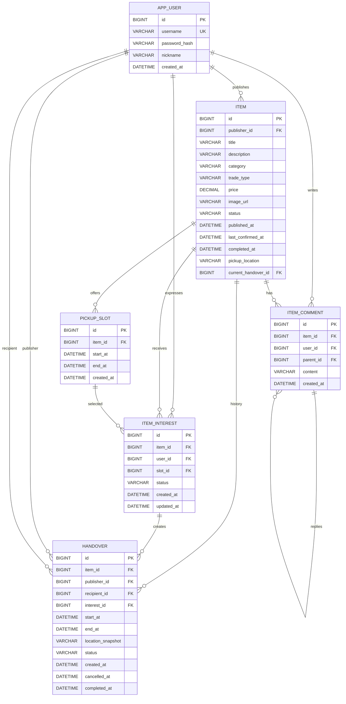

# 阶段 3 实际 ER 图

以下字段与 V1、V2、V3 迁移一致。

关键约束：`item_comment.parent_id` 为空表示顶层留言，非空时自关联同表；服务端限制最多一层且只能由物品发布者回复。时段结束晚于开始；`item_interest(item_id,user_id)` 唯一；当前有效交接由 `item.current_handover_id` 引用，并由确认事务的条件更新保证单一；handover 永久保存地点/时间快照与取消、完成历史。